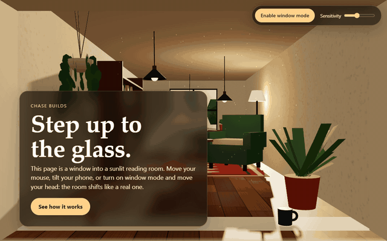
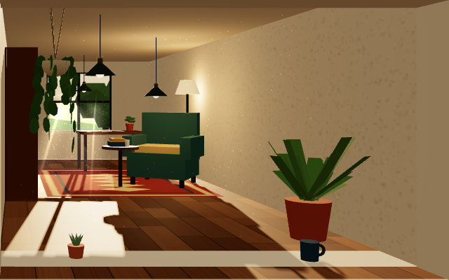
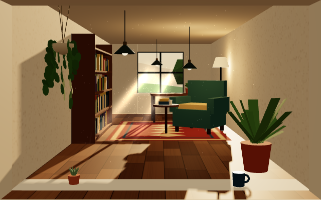
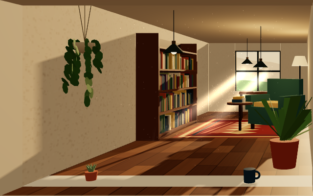

# Window Hero: a head-tracked window for landing pages

[](https://github.com/chasebuilds/window-hero/actions/workflows/ci.yml)
[](https://chasebuilds.github.io/window-hero/)

A landing-page hero where the screen acts like a window. Behind the headline is a 3D reading room. Move your head (with window mode on), tilt your phone, or move your mouse, and the room shifts the way a real room does through glass: the plants by the frame slide a lot, the bookcase less, the hills outside barely move.

**Live demo: https://chasebuilds.github.io/window-hero/**



The GIF is made by driving the eye position through a test hook (see [Tests](#tests)), not with a real camera.

| Eye left | Eye center | Eye right |
|---|---|---|
|  |  |  |

## Drop it on a page

One element and one script tag:

```html
<div id="hero"></div>
<script type="module"
  src="https://cdn.jsdelivr.net/gh/chasebuilds/window-hero@v1.0.0/src/window-hero.js"
  data-title="Fresh bread, every morning."
  data-text="Order by 9 pm and pick it up warm at 7."
  data-cta-text="Order ahead"
  data-cta-href="/order"></script>
```

| Attribute | What it does | Default |
|---|---|---|
| `data-title` | Headline, rendered as a real `<h1>` | "Step up to the glass." |
| `data-text` | Short paragraph under the headline | A one-line description |
| `data-cta-text`, `data-cta-href` | The call-to-action link | "See how it works", `#` |
| `data-eyebrow` | Small label above the headline | none |
| `data-target` | CSS selector of the element to fill | `#hero` |
| `data-height` | Hero height | `100svh` |
| `data-sensitivity` | Starting sensitivity, 0.3 to 2 | `1` |
| `data-model-url` | Self-hosted copy of `face_landmarker.task` | Google's model URL |

Or mount it from your own module:

```js
import { mount } from 'https://cdn.jsdelivr.net/gh/chasebuilds/window-hero@v1.0.0/src/window-hero.js';

const hero = mount(document.querySelector('#hero'), {
  title: 'Fresh bread, every morning.',
  text: 'Order by 9 pm and pick it up warm at 7.',
  cta: { label: 'Order ahead', href: '/order' },
  headingLevel: 1,        // 2 if the page already has an h1
  motion: 'auto',         // follows prefers-reduced-motion; true or false forces it
  scene: 'room',          // or a function (THREE) => ({ scene, layout(aspect), update(seconds) })
});
// hero.destroy() removes it and stops the camera.
```

There is no build step. The files in `src/` are plain ES modules; three.js r170 comes from jsDelivr at a pinned version. A bare example page is in [`examples/embed.html`](examples/embed.html).

## How it works

**Off-axis projection.** The screen is treated as a real window: a rectangle in the scene, 2 units tall, as wide as the screen's aspect ratio. The 3D camera sits at your eye and always looks straight ahead, and its view is cut to exactly that rectangle. That is an asymmetric frustum: when your eye moves right, the left edge of the view gets wider and the right edge narrower. Points on the glass stay fixed on screen (the unit test checks this for several eye positions) and everything behind the glass shifts by an amount that grows with depth. The math is in [`src/math.js`](src/math.js).

**Eye position from the face.** MediaPipe FaceLandmarker gives 478 face points per frame. The tracker takes the two iris centers:

- **Sideways and up/down:** the midpoint between the irises, compared with the midpoint saved during calibration. An offset in the image is an angle (assuming a 60 x 45 degree webcam), times your distance.
- **Distance:** the pixel gap between the irises. Lean in and it grows, so distance is the calibrated distance times calibrated gap over current gap.
- **Smoothing:** a One Euro filter on each axis. It smooths hard when your head is still (jitter drops by more than half in the unit test) and lets fast moves through (a 0.2 second move is followed to within 10% a quarter second later).
- **Calibration:** "Look straight at the screen, 3, 2, 1", then 0.6 seconds of samples are averaged as your neutral position. Recalibrate repeats it.
- **Sensitivity:** one slider scales the head, tilt and mouse movement (0.3 to 2).

**Fallbacks, in order:**

1. **Face** (only after the visitor presses Enable window mode and allows the camera).
2. **Tilt** on phones. Browsers that ask for motion permission (iOS Safari, recent Chromium) show a Tilt to look button; the permission request only happens on that tap.
3. **Mouse** on desktop.
4. **Still** when the system asks for reduced motion. Nothing moves, not even the dust, until the visitor presses Turn on motion or turns on window mode.

**The scene** ([`src/room.js`](src/room.js)) is original and procedural: a reading room with a window reveal and sill right at the glass, a hanging plant and a potted plant just inside, three pendant lamps at different depths, dust drifting in sun shafts, a bookcase, an armchair, a reading table and a garden with hills through the far window. Things sit at many depths on purpose, because the depth spread is what makes the effect read. On tall phone screens the room stays wider than the glass, like a narrow window onto a normal room.

A Gaussian splat scene was considered and left out: the procedural room has no license question, while a splat needs its license confirmed on its source page. The `scene` option takes a function if you want to plug in your own three.js scene.

## Privacy

- **The camera is off when the page loads.** Nothing asks for it until the visitor presses Enable window mode, reads a short explanation, and presses Use my camera.
- **Face tracking runs on the device.** MediaPipe runs in WebAssembly inside the tab. The video element is never added to the page, and frames go straight into the model. Only an eye position (three numbers) comes out, and it only moves the 3D camera.
- **Nothing is recorded or sent.** No video, frames or face points leave the page. There is no analytics, no cookies and no tracking of any kind.
- **Turn off camera** stops every camera track, so the browser's camera light goes off.
- **What does get downloaded:** when window mode is turned on, the browser fetches the MediaPipe code from jsDelivr and the face model file from Google's MediaPipe model storage. Those are ordinary file downloads; nothing about the visitor is uploaded. To avoid the Google request, host `face_landmarker.task` yourself and set `data-model-url`.
- **Lazy loading:** none of the MediaPipe files load until window mode is turned on, so they never affect page-load scores. The smoke test checks that no MediaPipe request happens on load.

## Accessibility

- The headline, paragraph and link are real DOM text, not drawn on the canvas. The canvas is `aria-hidden`.
- Text sits on a dark frosted panel (68% opaque) so it keeps contrast over bright parts of the room.
- Every control is a real button, reachable with Tab, with a visible focus ring. The explainer closes with Escape and returns focus.
- Status messages (permission declined, no camera, cannot see your face) use a polite live region.
- Reduced motion is respected by default, as described above.
- At 375 px wide there is no sideways scroll (tested).

## Measured

From [`docs/MEASURED.md`](docs/MEASURED.md) (rerun with `npm run measure`). Window 1280 x 720, device pixel ratio 1, dust moving, the eye sweeping a figure eight for 8 seconds:

| Setup | Frames per second |
|---|---:|
| RTX 5070, vsync and frame cap off | 1,070 |
| No GPU at all (SwiftShader software rendering on a Ryzen 5 7600X), full resolution | 8 |
| Same, with adaptive resolution (settled at half resolution) | 19 |

The scene is 123 draw calls and about 5,600 triangles per frame. Books, vine leaves and fern fronds are instanced, and shadows are drawn once per resize instead of every frame. If the frame rate stays under 40, the hero lowers its resolution in steps down to half; turn that off with `adaptive: false`. The software rows are a worst case (no graphics hardware at all); any device with a working GPU lands far closer to the first row. Not measured: a real phone, and the cost of face tracking, which needs a real camera.

Download size:

| What | When | Size over the wire |
|---|---|---:|
| Our modules (`window-hero.js`, `room.js`, `math.js`) | Page load | 15.7 KB gzipped |
| three.js r170 minified (jsDelivr) | Page load | 135.9 KB (brotli) |
| `tracker.js` | Window mode on | 1.0 KB gzipped |
| MediaPipe bundle + WebAssembly (jsDelivr) | Window mode on | 2.0 MB (brotli) |
| Face Landmarker model (Google storage) | Window mode on | 3.6 MB |

## Tests

`npm test` runs both suites; CI runs them on every push.

- **Unit (Node):** symmetric frustum for a centered eye, frustum shifts opposite the eye, points on the glass stay fixed for any eye, parallax grows with depth, iris and eye-corner face samples, face-to-eye mapping (sideways, up, lean in, sensitivity, clamping), calibration averaging, and the One Euro filter (steady input passes, jitter damped, fast motion followed).
- **Smoke (headless Chromium, SwiftShader WebGL):** loads with no console errors; the canvas renders a scene; the title is a real `h1` and the CTA a real link; `getUserMedia` (stubbed) is never called on load or on mouse moves; no MediaPipe file is requested on load; moving the eye through the test hook changes 87% of pixels and moving it back restores the exact frame; simulated face samples through calibration, mapping and smoothing move the eye and change the view; the mouse moves the view; under reduced motion the frame does not change at all, even with the mouse, until Turn on motion; Enable window mode is reachable with Tab, shows the explainer first, Escape closes it; Use my camera calls `getUserMedia` once and a denial falls back to the mouse with a plain message; at 375 px there is no horizontal overflow, the Tilt button appears and synthetic tilt events move the view; the drop-in script on a bare page mounts with its data attributes; and with Chromium's fake camera, MediaPipe loads only after consent, the countdown runs, "cannot see your face" is handled, and Turn off camera stops every track.

### Tested by simulation vs needs a real camera

There is no webcam on the test machines, so:

| Tested by simulation | Needs a real camera check |
|---|---|
| Camera not requested on load; explainer before any request; one request on consent | That the browser's own permission prompt appears and the camera light goes on and off |
| Permission declined and no-camera messages (stubbed `getUserMedia`) | How it feels: whether sensitivity 1 matches real head movement on a laptop webcam |
| MediaPipe loads only after consent, runs on Chromium's fake camera, reports "cannot see your face", and Turn off stops every track | Landmark quality and calibration with a real face, glasses, low light |
| Face samples through calibration, mapping and smoothing change the view | Tracking frame rate and the cost of tracking plus rendering on a phone |
| Eye positions through the test hook, mouse, tilt events, reduced motion | iOS motion-permission prompt on a real iPhone |

## Run it locally

```bash
npm install
npm run serve        # http://localhost:4173/
npm test             # unit + smoke
npm run measure      # frame rate and download sizes, writes docs/MEASURED.md
npm run screenshots  # README images and GIF (needs ffmpeg)
```

The camera needs a secure page: `localhost` counts, and so does any `https://` site.

## Credits

- [three.js](https://threejs.org/) r170 (MIT), loaded from jsDelivr.
- [MediaPipe Tasks Vision](https://www.npmjs.com/package/@mediapipe/tasks-vision) 0.10.21 and the Face Landmarker model (Apache 2.0), loaded only when window mode is on.
- One Euro filter: Casiez, Roussel and Vogel, CHI 2012.
- The room, its textures and all copy are original to this repo.

MIT license. Built by Chase Builds.

## More from Chase Builds

- **[dither-pond](https://github.com/chasebuilds/dither-pond)**: A stylized 3D scene with a day-to-night slider and a mix of animals, boat, bike, wind and water. ([live demo](https://chasebuilds.github.io/dither-pond/))
- **[notebook-shelf](https://github.com/chasebuilds/notebook-shelf)**: A shelf of notebooks that open in 3D. Great for portfolios, menus and catalogs. ([live demo](https://chasebuilds.github.io/notebook-shelf/))
- **[liquid-logo-studio](https://github.com/chasebuilds/liquid-logo-studio)**: Turns any logo into animated liquid chrome or gold, ready to export or embed. ([live demo](https://chasebuilds.github.io/liquid-logo-studio/))

[All projects, sorted by industry](https://github.com/chasebuilds) · [chasebuilds.github.io](https://chasebuilds.github.io)
